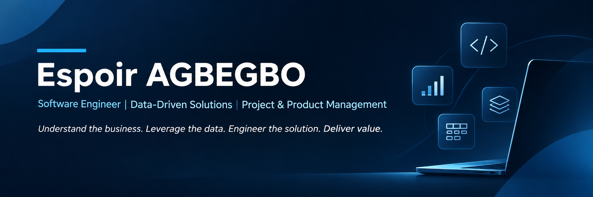

I am a Software Engineer with an entrepreneurial background and several years of experience designing, developing, and delivering digital products.

My interests lie at the intersection of software engineering, data-driven decision-making, and business strategy. I enjoy turning complex business challenges into reliable, scalable, and valuable technology solutions.

Currently pursuing a Master's degree in Computer Science and Business Management (MIAGE – MBDS) at Université Côte d'Azur, Sophia Antipolis, France.

## My Core Areas

### Software Engineering
Building reliable, scalable, and maintainable software systems through sound architecture and modern engineering practices.

### Data-Driven Solutions
Leveraging data, analytics, and artificial intelligence to solve business problems, improve processes, and support decision-making.

### Project & Product Management
Bridging business needs and technical execution, from product discovery and strategic planning to development and delivery.

## My Engineering Philosophy

**Understand the business. Leverage the data. Engineer the solution. Deliver value.**

## Engineering Skills & Technical Stack

### Programming Languages

### Frontend Engineering

### Backend Engineering & Architecture

### Databases & Data Management

### Cloud, Infrastructure & DevOps

### Software Quality

Unit Testing · Integration Testing · API Documentation · Code Quality

### Project & Product Management

Requirements Analysis · Product Design · Prototyping · Project Planning · Team Coordination

### Currently Exploring & Deepening

- Data Engineering & Business Intelligence
- Distributed Systems & Software Architecture
- Artificial Intelligence & Data-Driven Applications
- Java & Spring
- Financial Technology

## Selected Professional Projects

### Kauza — Professional Relationship Management Platform

**Role:** Product Manager, Project Manager & Software Developer

A SaaS platform helping individuals and businesses build,
manage, and strengthen professional relationships through
digital networking, data-driven insights, and AI assistance.

**Key Features**
- Digital professional profiles and QR-based networking
- Bidirectional contact information exchange
- Contact management and appointment scheduling
- Relationship scoring and prioritization
- AI-powered relationship management assistant
- Corporate employee profile management
- Advertising-supported monetization

**My Contributions**
- Product management and feature definition
- Project planning and team coordination
- Full-stack software development
- Production deployment and infrastructure management
- Application maintenance and continuous improvement

**Results**
- Successfully deployed to production
- Reached approximately 100 users
- Managed the end-to-end product development lifecycle

**Tech Stack:** Remix · TypeScript · FastAPI · Python ·
MongoDB · Vercel · VPS

*Private repository — source code not publicly available.*

---

### Intelligent Virtual Assistant Management Platform

**Role:** Software Developer & Business Development Contributor

A platform enabling businesses to create, configure,
deploy, and manage intelligent virtual assistants,
powered by a customized version of the open-source
Rasa conversational AI framework.

**My Contributions**
- End-to-end frontend development of the proof of concept
- Platform maintenance and production redeployment
- Contribution to customer acquisition strategies
- Contribution to product pitching and marketing initiatives

**Tech Stack:** Remix · FastAPI · Python · Rasa ·
Microsoft Azure · HTML · CSS · JavaScript

**Domains:** Conversational AI · Enterprise Software ·
Cloud Computing · Product Development

*Private project — source code not publicly available.*

---

### BSIC — Omnichannel Intelligent Assistant Platform

**Role:** End-to-End Software Developer

An enterprise platform designed to help a banking institution
create, configure, and manage multiple intelligent virtual
assistants across different communication channels.

**Business Objectives**
- Automate responses to customer inquiries
- Improve customer service accessibility
- Streamline customer complaint and ticket management
- Centralize virtual assistant management
- Support multiple assistants with distinct responsibilities

**Target Channels**
- WhatsApp
- Facebook
- Corporate website

**My Contributions**
- Business requirements analysis
- End-to-end application development
- Software architecture and API design
- Frontend and backend implementation
- Database design and integration
- Docker-based infrastructure configuration
- MVP delivery and client demonstration

**Project Status:** MVP developed and demonstrated to the
client. Not yet adopted or deployed into production.

**Tech Stack:** Next.js · FastAPI · Python · PostgreSQL ·
Redis · Docker · Docker Compose

**Domains:** Banking · Conversational AI · Customer Service
Automation · Enterprise Software Engineering

*Private repository — source code not publicly available.*

---

### SmartFits — AI-Powered Wardrobe & Outfit Assistant

**Role:** Software Engineer & AI Solution Developer

An intelligent mobile application designed to transform
wardrobe images into structured clothing inventories and
generate personalized outfit recommendations.

**Key Features**
- Clothing detection and identification from images
- Automated digital wardrobe inventory
- AI-powered outfit recommendations
- Integration of multiple AI models

**My Contributions**
- Technical feasibility and operational cost analysis
- AI model benchmarking and selection
- Evaluation of model accuracy and response times
- Design of reliable and efficient AI processing pipelines
- Containerization of AI models for experimentation
- Mobile application development
- API development for mobile and AI model integration
- Proof of concept development

**Engineering Challenges**
- AI inference latency
- Model accuracy and reliability
- Infrastructure and inference costs
- Pipeline robustness and scalability
- Integration of multiple AI models

**Tech Stack:** Flutter · Dart · Docker · REST APIs ·
Artificial Intelligence · Computer Vision

**Planned Integration:** Firebase

**Project Status:** Proof of concept completed.
MVP currently under development.

*Private repository — source code not publicly available.*

## Let's Connect

I'm interested in building meaningful technology solutions
at the intersection of software engineering, data, and business.

Open to professional opportunities, technical collaborations,
and innovative product development projects.

- LinkedIn: [My LinkedIn Profile](https://www.linkedin.com/in/espoir-jacques-kwassi-agbegbo-4b6306432/)
- Email: [Contact me](mailto:jagbegbo@gmail.com)
